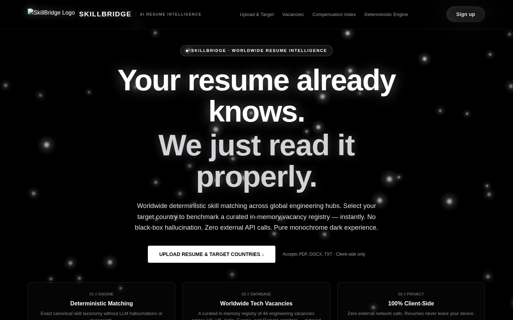
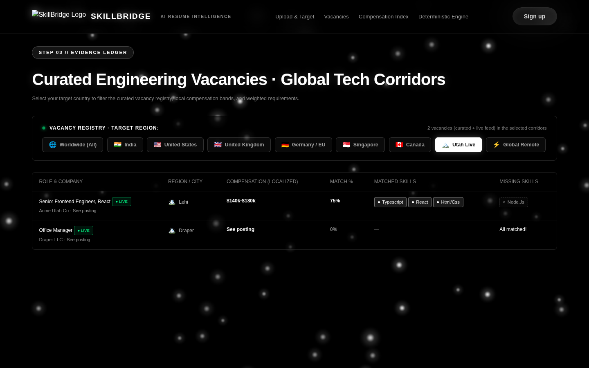
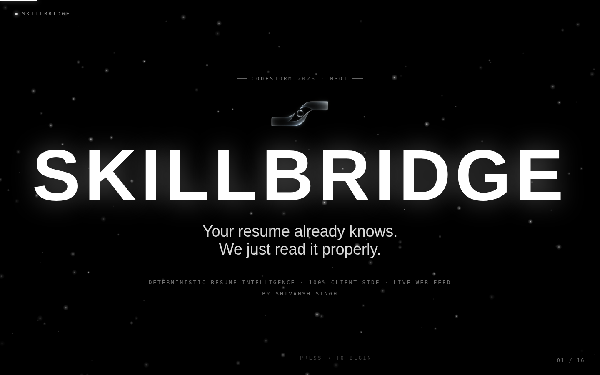

# SkillBridge

**Your resume already knows. We just read it properly.**

SkillBridge is a deterministic, client-side resume intelligence app. Upload a resume (PDF, DOCX, TXT) and it extracts your skills, scores you against real job openings with a transparent weighted formula, and tells you exactly which skills to learn next — all inside your browser. No black-box AI, no hallucination, no uploads.



## ✨ Features

- **Resume parsing in-browser** — PDF via `pdf.js`, DOCX via `mammoth`, TXT natively. Your resume never leaves your device.
- **Skill extraction** — token + bigram/trigram analysis resolved through a canonical taxonomy (39 skills · 98 aliases: `JS` → JavaScript, `K8s` → Kubernetes).
- **Deterministic weighted scoring** — `fit = (Σ w·matched / Σ w·required) × 100`, with employer-priority weights per role. Same resume in → same score out, every time.
- **Live job feed** — pulls real openings from the web (including a Utah corridor) with ● LIVE badges; a curated 44-role registry across 8 global corridors stays as the offline fallback.
- **Actionable outputs** — market-readiness score, ranked vacancies with matched/missing skills, and a demand-ranked skill-gap roadmap.
- **Cinematic monochrome UI** — custom dependency-free canvas starfield with parallax drift.



## 🚀 Run it

No build step. Just open `index.html` in a browser (or serve the folder):

```bash
npx serve .
```

## 🧠 How it works

1. **Ingest** — resume parsed locally (pdf.js / mammoth).
2. **Tokenize** — n-gram windows preserve compound terms (`machine learning`, `spring boot`).
3. **Resolve** — aliases mapped to canonical skills.
4. **Sync** — live listings fetched from a public job feed; required skills inferred through the same taxonomy.
5. **Score** — weighted fit against every role; results ranked and explained.

## 🛠 Tech

HTML · CSS · Vanilla JS · pdf.js · mammoth · Canvas2D starfield engine

## 📽 Presentation

`skillbridge-deck.html` is the full 16-slide animated pitch deck (CodeStorm 2026) — open it in a browser and present with → / space / click.



## 📄 License

MIT — see [LICENSE](LICENSE).
